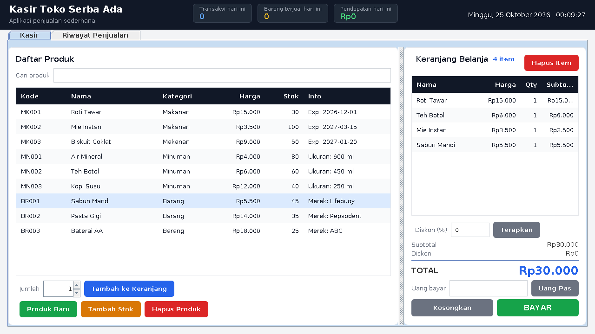
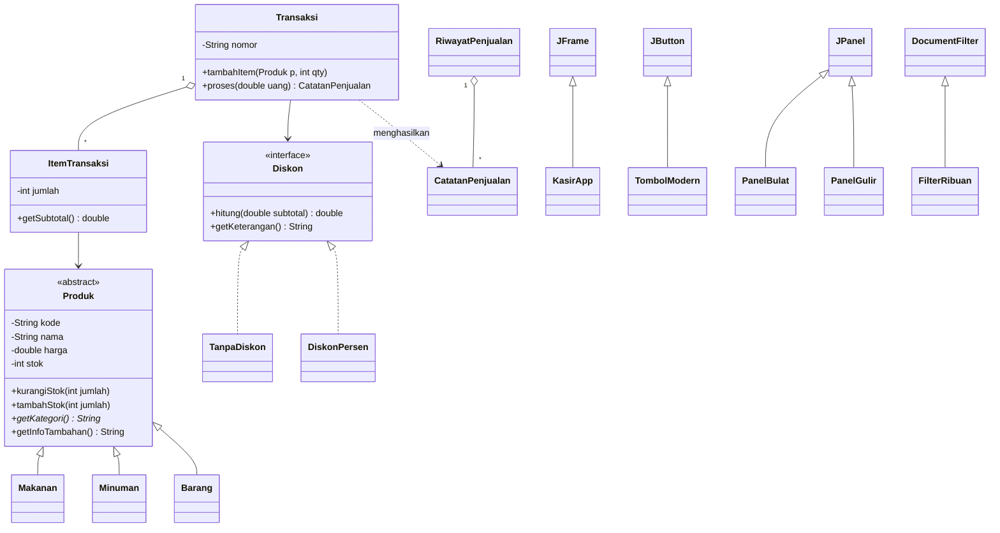

# Aplikasi Kasir Sederhana (Java Swing + PBO)

Aplikasi kasir desktop berbasis **Java Swing** yang dibuat dengan menerapkan konsep **Pemrograman Berorientasi Objek (PBO)**: pewarisan, abstraksi, polymorphism, enkapsulasi, interface, dan komposisi.



## Fitur
- Daftar produk dengan pencarian langsung (nama, kode, atau kategori)
- Keranjang belanja, diskon persen, uang pas, dan struk pembayaran
- Input uang otomatis diberi titik ribuan (`50000` menjadi `50.000`)
- Kelola produk: tambah produk baru, tambah stok, hapus produk
- Rekap hari ini: jumlah transaksi, barang terjual, dan pendapatan
- Riwayat penjualan per tanggal atau semua, klik transaksi untuk melihat struk
- Riwayat tersimpan otomatis di `riwayat_penjualan.txt`

## Cara menjalankan
Butuh **JDK 17 atau lebih baru** (cek dengan `javac -version`).

Windows PowerShell:
```
javac (Get-ChildItem *.java).Name
java Main
```
Windows CMD, Linux, atau macOS:
```
javac *.java
java Main
```
Atau unduh `KasirApp.jar` dari halaman **Releases**, lalu jalankan dengan `java -jar KasirApp.jar`.

## Penerapan konsep PBO
| Konsep | Penerapan di kode |
|---|---|
| **Abstraction** | `Produk` adalah abstract class (method abstrak `getKategori()`); `Diskon` adalah interface |
| **Inheritance** (pewarisan) | `Makanan`, `Minuman`, `Barang` meng-extend `Produk`; `TombolModern` meng-extend `JButton`; `PanelBulat` dan `PanelGulir` meng-extend `JPanel`; `FilterRibuan` meng-extend `DocumentFilter` |
| **Polymorphism** | `getKategori()` dan `getInfoTambahan()` (override di tiap jenis produk); `Diskon.hitung()` berbeda pada `TanpaDiskon` dan `DiskonPersen`; `List<Produk>` menampung semua jenis produk |
| **Encapsulation** | Atribut `private` dengan getter/setter; validasi stok hanya lewat `kurangiStok()` |
| **Interface** | `Diskon` diimplementasikan oleh `TanpaDiskon` dan `DiskonPersen` |
| **Composition** | `Transaksi` memiliki banyak `ItemTransaksi`, dan `ItemTransaksi` memiliki satu `Produk` |

## Diagram kelas


## Struktur file
| File | Peran |
|---|---|
| `Produk`, `Makanan`, `Minuman`, `Barang` | Model produk (pewarisan dan polymorphism) |
| `Diskon`, `TanpaDiskon`, `DiskonPersen` | Strategi diskon (interface) |
| `ItemTransaksi`, `Transaksi` | Logika keranjang dan pembayaran |
| `CatatanPenjualan`, `RiwayatPenjualan` | Riwayat penjualan dan penyimpanan ke file |
| `ProdukRepository` | Penyimpanan data produk |
| `KasirApp`, `Main` | Tampilan (GUI) dan titik masuk program |
| `Tema`, `TombolModern`, `PanelBulat`, `PanelGulir`, `FilterRibuan`, `Util` | Komponen tampilan dan utilitas |
